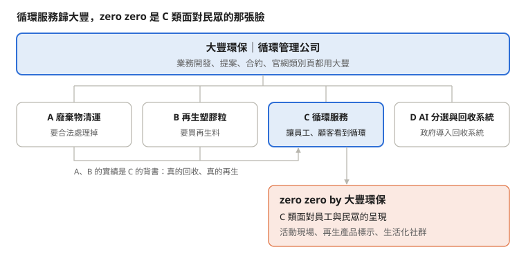

# 循環服務業務視角｜大豐環保 × zero zero：循環服務歸屬與品牌分工

2026-10-21 · 循環服務業務

## 一、摘要

**一語道破：大豐環保是做回收再生的公司。** 集團定位用「循環管理」，業務電話裡用「回收再生」。

- **大豐是客戶要記住的名字**：「回收」接清運與處理，「再生」接材料、產品與活動，四類都容得下。
- **循環服務（C 類）歸大豐**，業務以產品與活動為主角，回收再生實績是背書。
- **zero zero 是成果的名字，不是另一家公司**：產品、聯名、活動、策展掛「zero zero by 大豐環保」，窗口與合約是大豐；不追加人力。
- **品牌分工依「對誰說」**：對採購與決策者是大豐，對活動現場與社群觀眾是 zero zero。
- **「循環服務」名稱對外不好懂，需要討論。**

## 二、第一線現況

**電話接通的前 10 秒，缺一句話說清楚大豐是做什麼的。** 王品讓人想到牛排、遠東讓人想到紡織或百貨，大豐還沒有這個錨點；官網 17 項服務清運就占 10 項。

| 對外說法 | 客戶聽到的 | 問題 |
| --- | --- | --- |
| 做廢棄物清運的 | 比價的清運廠商 | 接不到產品、活動、展覽 |
| 做再生材料的 | 材料商 | 不採購材料就結束對話 |
| 做循環服務的 | 聽不懂 | 電話裡沒時間再解釋 |

zero zero 目前也接不住：知名度不足以單靠品牌談聯名、沒有專職人力、App 10/28 停止營運，而且「清運是大豐、活動是 zero zero」讓客戶要記兩個名字。但它有大豐沒有的中性品牌感、社群基礎，以及 VOGUE 野餐日、品牌聯名等實績。

## 三、問題根源

**問題不在服務太多，而在用「服務清單」介紹自己。**

1. **沒有主打字眼**：每次從不同服務切入，客戶每次記住的都不同；「循環管理」也需要一句白話。
2. **服務沒串成一條線**：清運到產品、活動是同一個「廢料變資源」流程，對外卻分開講。
3. **品牌依 B / C 劃分不符實際**：zero zero 的聯名、活動付費者是企業，本質仍是 B2B。
4. **「循環服務」是內部用語**：客戶說的是「想讓員工、顧客看到公司有在做循環」。

## 四、大豐環保：一句話定義

**分兩層：集團定位用「循環管理」，對外一語道破用「回收再生」。**

> 大豐環保是做回收再生的——企業的廢料交給我們，我們回收、處理，再變成再生材料，甚至做成產品和活動。

| 說法 | 客戶聽不聽得懂 | 建議用在 |
| --- | --- | --- |
| 回收再生 | 聽得懂，也接得到產品 | 業務電話、簡報開場 |
| 循環管理 | 要補一句白話 | 集團定位、官網 |
| 廢棄物清運 | 聽得懂，但像比價廠商 | 只用在 A 類客戶 |
| 再生材料 | 聽得懂，但像材料商 | 只用在 B 類客戶 |
| 循環服務 | 聽不懂 | 不單獨對外使用 |

表二參考：「大豐環保是循環管理公司：幫企業與政府把廢棄物合法處理、分選再生成原料，再變成看得見的循環成果。」標語沿用「零廢棄・全循環」。

## 五、C 類業務怎麼介紹

**先用「回收再生」說我們是誰，再馬上講客戶拿得到的產品、活動、展覽。**

### 10 秒版（開場）

> 「您好，我是大豐環保的 OOO，我們是做回收再生的。我們可以把貴公司自己的廢料，變成再生產品、禮贈品，或回收活動、循環展覽。請問貴公司今年有在規劃永續相關的活動或禮品嗎？」

### 30 秒版（對方有興趣）

先補一句背書：「回收、處理、再生都是我們自己做，每件成果都說得清楚從哪裡來。」再依對方在意的事接：

| 客戶在意 | 接一句 |
| --- | --- |
| ESG 報告 | 「從回收到做成產品都有紀錄，可以寫進永續報告。」 |
| 員工參與 | 「可以在公司辦回收活動或 DIY。」 |
| 品牌行銷、禮贈品 | 「用貴公司的廢料做聯名產品，故事是你們自己的。」 |
| 對外展示 | 「可以策劃循環展覽，把成果展示出來。」 |

對方要的是清運或再生料，再帶到 A、B 類。zero zero 到提案與案例階段才出現。

## 六、需要討論：「循環服務」這個名稱

**「循環服務」四個字對外不好溝通，建議列入類別名稱討論。**

- 客戶聽不出我們要提供什麼，電話裡還要再解釋。
- 客戶不會說「我需要循環服務」。
- 「服務」容易跟 A 類的清運服務混在一起。

新名稱應讓客戶一聽就知道能拿到什麼（產品、活動、展覽）。

## 七、循環服務歸屬（表六第 1 項）

**建議方案 C：歸大豐，產品、活動與策展以「zero zero by 大豐環保」呈現。**

| 方案 | 優點 | 風險 |
| --- | --- | --- |
| A. 全歸大豐，收掉 zero zero | 只剩一個名字 | 失去品牌感，難談品牌聯名；VOGUE 等累積歸零 |
| B. 歸 zero zero | 品牌感強 | 客戶要認兩家公司；與回收再生實績脫鉤；無專職人力 |
| **C. 歸大豐，zero zero by 大豐呈現** | 形象累積在大豐，保留品牌感，不加人力 | 需訂標示規則 |

**表六建議填法**

| 問題 | 建議 | 暫用假設 |
| --- | --- | --- |
| 循環服務歸大豐還是 zero zero | 歸大豐 C 類 | C 類說明頁放大豐官網；zero zero 官網與商城放產品與活動，連回大豐 |

## 八、建議品牌架構

**四類都在大豐底下；C 類靠回收再生實績背書，成果掛 zero zero。**

## 九、後續規劃

**如果採用這份建議，接下來可以做這幾件事。**

主管的曝光計畫裡，要大家提出 2027 年具體要做的工作，每件事都要幫助三個目標之一：短影音破 10 萬觀看、社群追蹤數、官網進站次數。從循環服務的角度，建議放進去這三件：

| 建議做的事 | 具體內容 | 幫助哪個目標 |
| --- | --- | --- |
| 拍循環服務系列短影音 | 每支講一個客戶案例：客戶的問題 → 他的廢料 → 我們怎麼回收處理 → 變成什麼產品或活動 | 短影音觀看 |
| 官網新增循環服務介紹頁 | 一頁講清楚能做哪些產品、活動、展覽，放已完成的案例；zero zero 官網連到這頁 | 官網進站 |
| 整理案例集與提案範本 | 把 VOGUE 野餐日、品牌聯名產品等案例，整理成業務提案用的資料 | 不直接對應，是業務工具 |

案例要先取得客戶同意才能公開。

**業務這邊自己可以先做的**

- [ ] 把第五段的電話話術實際用在開發上
- [ ] 做一張一頁式圖，說明從回收、再生到產品和活動的流程，開發時給客戶看
- [ ] 整理案例集，逐一確認客戶同意公開
- [ ] 定期回報哪種說法客戶比較聽得懂，給行銷部調整參考
